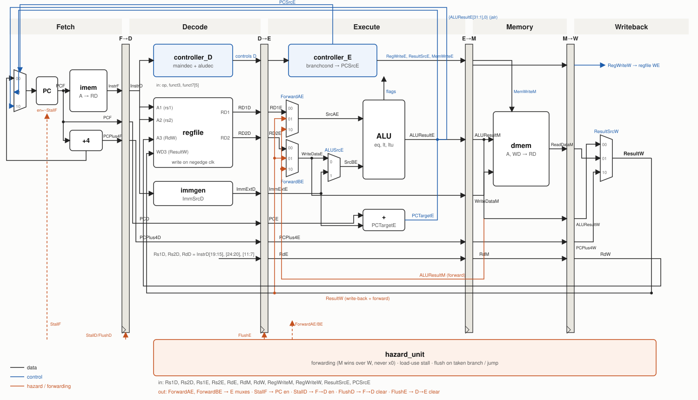
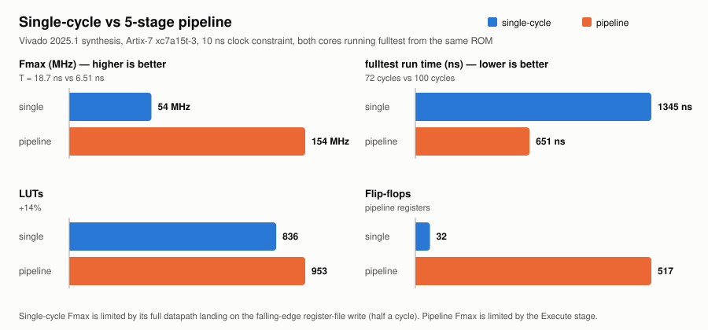
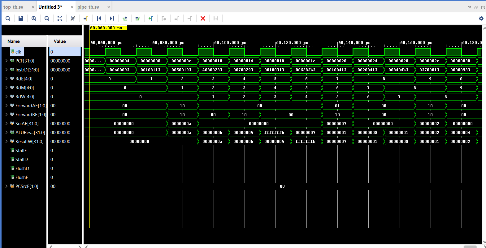
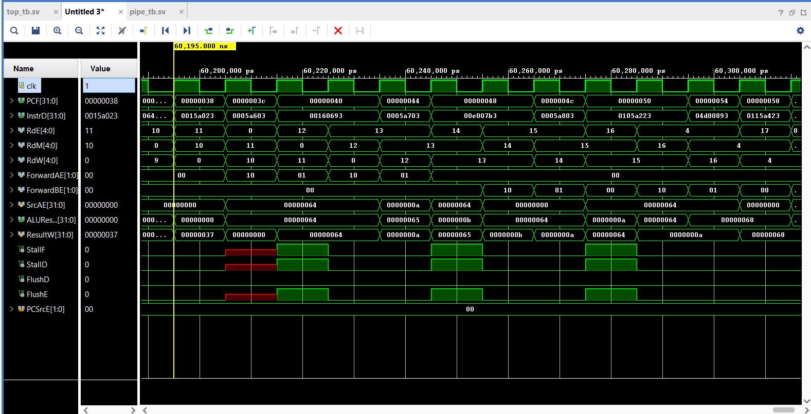
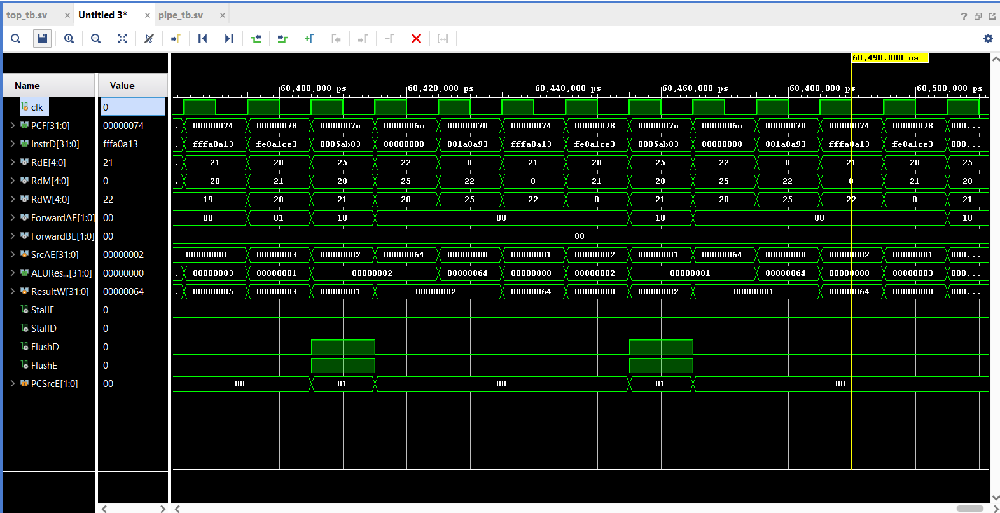
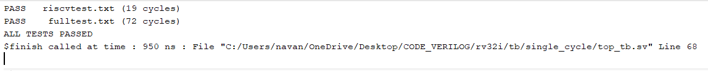
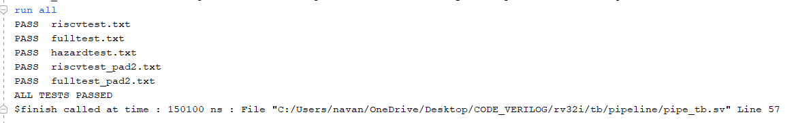

# RV32I Pipelined Core

A 32-bit RISC-V (RV32I subset) processor in Verilog, built in two versions that share the same datapath blocks:

- **Single-cycle**: every instruction completes in one clock cycle.
- **5-stage pipeline** (Fetch, Decode, Execute, Memory, Writeback) with a hazard unit for **data forwarding**, **load-use stalling** and **branch/jump flushing**.

The design follows *Digital Design and Computer Architecture, RISC-V Edition* (Harris & Harris), Chapter 7, with signal names kept close to the book. It was simulated and synthesized in Xilinx Vivado 2025.1.



## Results

| | Single-cycle | 5-stage pipeline |
|---|---|---|
| Tests | 2 / 2 programs pass | 5 / 5 programs pass (3 with no NOP padding) |
| Fmax (Artix-7 xc7a15t-3) | ≈ 53 MHz | **≈ 154 MHz (2.9×)** |
| `fulltest` run time | 72 cycles × 18.7 ns = 1345 ns | 100 cycles × 6.51 ns = **651 ns (2.1×)** |
| LUTs / flip-flops | 836 / 32 | 953 / 517 |



Details and the critical paths are in [Synthesis](#synthesis).

## Supported instructions

| Format | Instructions |
|---|---|
| R | `add` `sub` `and` `or` `xor` `sll` `srl` `sra` `slt` `sltu` |
| I (ALU) | `addi` `andi` `ori` `xori` `slti` `sltiu` `slli` `srli` `srai` |
| I (load / jump) | `lw` `jalr` |
| S | `sw` |
| B | `beq` `bne` `blt` `bge` `bltu` `bgeu` |
| J | `jal` |

Not implemented: U-type (`lui`, `auipc`), byte/halfword loads and stores, `ecall`/`ebreak`/`fence` and CSRs. An unknown opcode decodes to all-zero controls, so it behaves as a NOP.

## Repository layout

```
rtl/
  common/        alu, aludec, maindec, branchcond, immgen, regfile, imem, dmem, flip-flops
  single_cycle/  controller, datapath, riscv_single (core), top (core + memories)
  pipeline/      controller_D, controller_E, datapath_pipe, hazard_unit, riscv_pipe (core), top_pipe
tb/
  unit/          regfile, alu, immgen, dmem testbenches
  single_cycle/  controller_tb, top_tb
  pipeline/      pipe_tb
programs/        test programs (.s), machine code (.txt), expected results, rvasm.py
constraints/     clock.xdc (10 ns clock)
docs/            diagrams, control tables, waveforms, synthesis reports
```

## Microarchitecture

### Shared blocks

- **ALU**: 4-bit `ALUControl = {instr[30], funct3}`, so the encoding comes straight from the instruction. Instead of a single `Zero` flag it outputs three flags, `eq`, `lt` (signed) and `ltu` (unsigned), and `branchcond` turns `funct3` and the flags into `BranchTaken` for all six branches.
- **Next PC**: a 3-input mux selected by 2-bit `PCSrc`: `00` = PC + 4, `01` = PC + imm (branch or `jal`), `10` = `{ALUResult[31:1], 0}` (`jalr`).
- **Register file**: two combinational read ports and one write port. `x0` is handled on the read side (reading register 0 returns 0), and writes to `rd = 0` are ignored. Writes happen on the **falling** clock edge.
- **Memories**: `imem` (256 words, loaded with `$readmemh`) and `dmem` (64 words) are word-addressed with `a[AW+1:2]` and parameterized in size. Both have combinational reads, and `dmem` writes on the rising edge.

Control tables (main decoder, ALU decoder, branch conditions, immediate formats) are in [`docs/single_cycle/control_tables.md`](docs/single_cycle/control_tables.md).

### Pipeline

The pipeline registers are built from four flip-flop modules (`flopr`, `flopenr`, `floprc`, `flopenrc`) with an asynchronous reset, a synchronous clear and an enable. Clear wins over enable.

| Register | Holds | Stall (enable) | Flush (clear) |
|---|---|---|---|
| F→D | InstrD, PCD, PCPlus4D | `~StallD` | `FlushD` clears InstrD only (all-zero instruction = NOP) |
| D→E | controls, RD1, RD2, ImmExt, PC, PCPlus4, Rs1, Rs2, Rd, funct3 | — | `FlushE` clears the **control** signals only |
| E→M, M→W | results, write data, Rd, controls | — | — |

The control unit is split by stage: `controller_D` decodes (main decoder + ALU decoder), and `controller_E` makes the branch decision (`branchcond` + `PCSrcE`) once the ALU flags are available.

### Hazard unit

| Hazard | Detection | Action |
|---|---|---|
| RAW, distance 1 | `Rs1E/Rs2E == RdM`, `RegWriteM`, source ≠ x0 | forward `ALUResultM` (`ForwardAE/BE = 10`) |
| RAW, distance 2 | `Rs1E/Rs2E == RdW`, `RegWriteW`, source ≠ x0 | forward `ResultW` (`01`). M has priority over W, because it is newer |
| RAW, distance 3 | same cycle as the write-back | handled by the falling-edge register-file write: Writeback writes in the first half of the cycle and Decode reads in the second half |
| Load-use | `ResultSrcE == 01` (load in E) and `Rs1D` or `Rs2D == RdE` | `StallF`, `StallD`, `FlushE`: a 1-cycle bubble, after which the value is forwarded from W |
| Taken branch / `jal` / `jalr` | `PCSrcE ≠ 00` | `FlushD`, `FlushE`: the two wrong-path instructions are discarded (2-cycle penalty) |

Waveforms from `hazardtest` (Vivado):

| Forwarding | Load-use stall | Branch flush |
|---|---|---|
|  |  |  |

More on each window: [`docs/pipeline/`](docs/pipeline/).

### Design decisions

- **A load-use stall instead of forwarding `ReadDataM`.** Forwarding the memory output back into Execute would remove the stall, but it would put the data memory read in series with the ALU and the branch decision. That is the longest path in the design, and Fmax would drop. One bubble per load-use pair costs less.
- **Flush clears only the control bundle of D→E.** A bubble only needs `RegWrite`, `MemWrite`, `Jump`, `Branch` and `Jalr` = 0, so it cannot write anything or redirect the PC. The 32-bit data fields keep plain `flopr` registers, so no clear logic is spent on them.
- **Branches are resolved in Execute**, as in the book. This keeps the ALU comparison out of Decode, at a cost of 2 cycles per taken branch.
- **One shared register file with a falling-edge write.** The pipeline needs it for the distance-3 case. The single-cycle core uses the same module, so its whole datapath (PC → imem → regfile → ALU → dmem → regfile) has to fit in half a cycle. That is why its Fmax is about 53 MHz rather than about 107 MHz with a rising-edge write.

## Verification

All testbenches are self-checking SystemVerilog. They compare every register `x1`–`x31` and every data-memory word against expected values, using `!==` so that X counts as a mismatch.

| Program | Instructions | What it covers |
|---|---|---|
| `riscvtest` | 21 | The book's test program (Section 7.6.3): must store 25 to address 100 |
| `fulltest` | 75 | Every supported instruction, negative immediates, signed/unsigned compares, all 6 branches taken and not taken, `jal`/`jalr` (including an odd `jalr` target) |
| `hazardtest` | 52 | Forwarding from M and from W, M-over-W priority, `x0` never forwarded, back-to-back load-use, a load feeding a store's data, taken branches, `jal`/`jalr` flushes |
| `*_pad2` | — | `riscvtest` and `fulltest` with 2 NOPs after every instruction, to check the pipeline structure with no hazards at all |

Expected results come from `programs/rvasm.py`, a small assembler and reference simulator (`python rvasm.py prog.s [--pad N]`).

| Single-cycle (`top_tb`) | Pipeline (`pipe_tb`) |
|---|---|
|  |  |

`hazardtest` was also checked against deliberately broken versions of the hazard unit. Each fault is caught:

| Fault injected | Mismatches |
|---|---|
| no `Rs ≠ x0` check in forwarding | 12 |
| no forwarding from M | 17 |
| no forwarding from W | 15 |
| no load-use stall | 6 |
| no flush on taken branch / jump | 6 |

Unit testbenches cover `regfile`, `alu`, `immgen`, `dmem` and the single-cycle `controller` (30 checks).

## Synthesis

Vivado 2025.1, part xc7a15tcpg236-3, 10 ns clock constraint ([`constraints/clock.xdc`](constraints/clock.xdc)). Both tops include the memories, with `fulltest` in the ROM.

| | `top` (single-cycle) | `top_pipe` (pipeline) |
|---|---|---|
| LUTs (logic + LUTRAM) | 836 (756 + 80) | 953 (873 + 80) |
| Flip-flops | 32 (PC) | 517 |
| BRAM / DSP | 0 / 0 | 0 / 0 |
| Critical path | PC → imem → regfile → ALU → dmem → result mux → regfile write: 9.15 ns, 12 logic levels, in a **5 ns** half-cycle window | Rs2E → forwarding compare → forwarding mux → SrcB mux → ALU `ltu` carry chain → BranchTakenE → PCSrcE → FlushD → F→D enable: 6.29 ns, 13 logic levels |
| Minimum period | 2 × 9.34 = 18.7 ns | 6.51 ns |
| **Fmax** | **≈ 53 MHz** | **≈ 154 MHz** |

- The register file (48 LUTs) and data memory (32 LUTs) map to distributed RAM. The 75-word ROM is folded into logic, so the LUT count depends on the program loaded.
- The pipeline's limit is the Execute stage, which does forwarding, the ALU and the branch decision in one cycle. Moving branch resolution into Decode, or balancing the stages, would be the next step.
- The pipeline needs more cycles (100 vs 72 on `fulltest`, because of pipeline fill, 1 load-use stall and 13 taken redirects × 2 cycles), but each cycle is 2.9× shorter.

Full reports: [`docs/synth/`](docs/synth/).

## Running it

**Vivado**
1. Add `rtl/**/*.v` and `programs/fulltest.mem` as design sources, and `tb/**/*.sv` and `programs/*.txt` as simulation sources. Leave *Copy sources into project* unchecked.
2. Add `constraints/clock.xdc`.
3. Set `top_tb` or `pipe_tb` as the simulation top and run. `top_tb` finishes in the first 1000 ns. For `pipe_tb`, type `run all` once (it takes 150 µs of simulated time).
4. To synthesize, set `top` or `top_pipe` as the top module.

**Icarus Verilog** (from the `programs/` folder, so `$readmemh` finds the files):
```
iverilog -g2012 -o pipe.vvp ../rtl/common/*.v ../rtl/pipeline/*.v ../tb/pipeline/pipe_tb.sv
vvp pipe.vvp
```

## Documentation

- [`docs/single_cycle/`](docs/single_cycle/): single-cycle datapath, hierarchy, block diagram of every module, control tables
- [`docs/pipeline/`](docs/pipeline/): pipelined datapath, pipeline registers, hazard unit, waveforms
- [`docs/synth/`](docs/synth/): Vivado utilization and timing reports

## Reference

S. Harris and D. Harris, *Digital Design and Computer Architecture, RISC-V Edition*, Morgan Kaufmann, 2021. Chapter 7.
