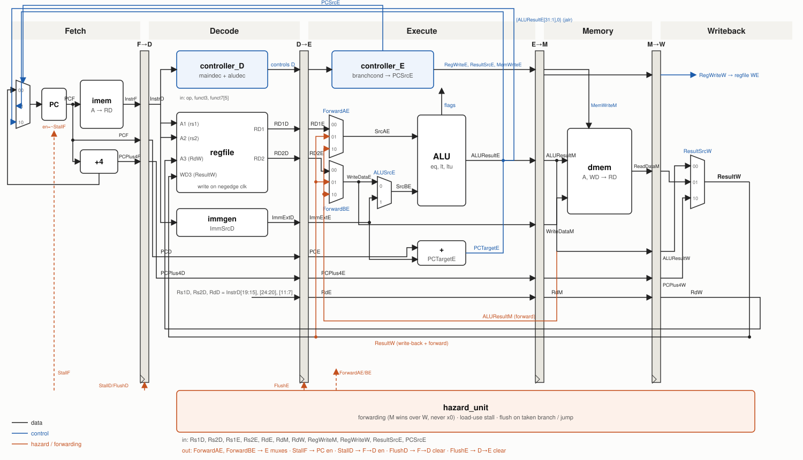
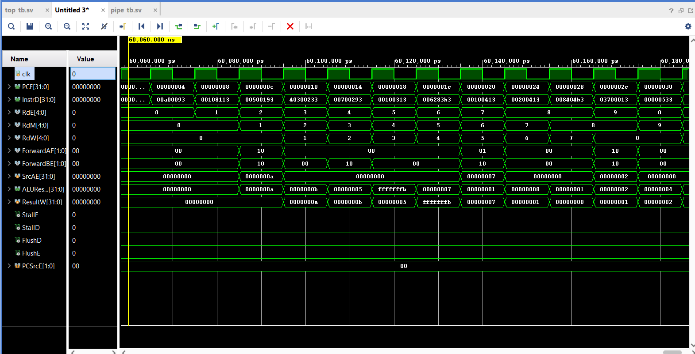
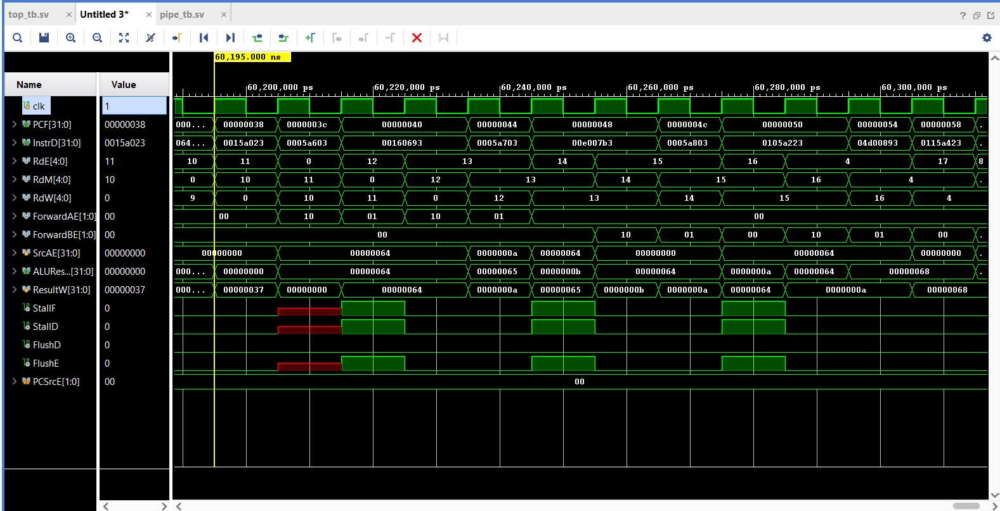
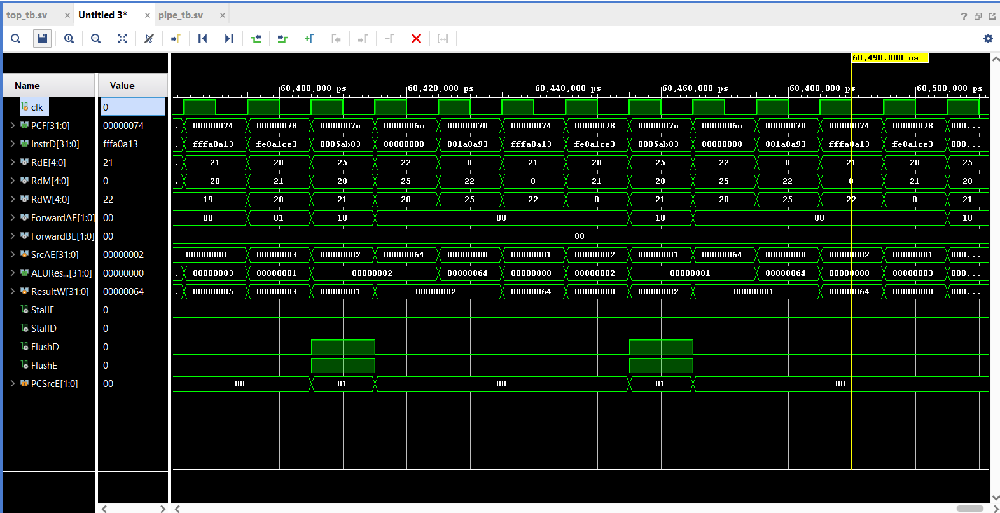

# Pipeline design documentation



Black wires are data, blue wires are control, and orange wires are hazard handling and forwarding.

## Modules

| Module | Role |
|---|---|
| `riscv_pipe` | Core: `controller_D` (`ctrlD`), `controller_E` (`ctrlE`), `datapath_pipe` (`dp`) |
| `top_pipe` | Core + `imem` (`instr_mem`) + `dmem` (`Data_mem`) |
| `controller_D` | Decode-stage control: `maindec` + `aludec` → RegWriteD, ResultSrcD, MemWriteD, JumpD, BranchD, JalrD, ALUControlD, ALUSrcD, ImmSrcD |
| `controller_E` | Execute-stage control: `branchcond` + `PCSrcE = Jalr ? 10 : (Branch & BranchTaken) \| Jump ? 01 : 00` |
| `datapath_pipe` | The five stages, the four pipeline registers and the `hazard_unit` (`HU`) |
| `hazard_unit` | ForwardAE/BE, StallF, StallD, FlushD, FlushE |

## Pipeline registers

Instance names follow `SignalFromTo_reg`, e.g. `RegWriteEM_reg`.

| Register | Flip-flop | Signals |
|---|---|---|
| PC | `flopenr`, en = `~StallF` | PCF |
| F→D | `flopenrc` (InstrD: clear = `FlushD`), `flopenr` (PCD, PCPlus4D), en = `~StallD` | InstrD, PCD, PCPlus4D |
| D→E | `floprc`, clear = `FlushE` | RegWrite, MemWrite, Jump, Branch, Jalr, ResultSrc |
| D→E | `flopr` | ALUControl, ALUSrc, funct3, RD1, RD2, ImmExt, PC, PCPlus4, Rs1, Rs2, Rd |
| E→M | `flopr` | RegWrite, ResultSrc, MemWrite, ALUResult, WriteData, PCPlus4, Rd |
| M→W | `flopr` | RegWrite, ResultSrc, ALUResult, ReadData, PCPlus4, Rd |

## Hazard unit

```
ForwardAE = 10  if Rs1E == RdM && RegWriteM && Rs1E != 0     (ALUResultM)
            01  if Rs1E == RdW && RegWriteW && Rs1E != 0     (ResultW)
            00  otherwise                                    (RD1E)
ForwardBE   same with Rs2E

lwStall  = ResultSrcE == 01 && (Rs1D == RdE || Rs2D == RdE)
StallF   = StallD = lwStall
FlushD   = PCSrcE != 00
FlushE   = lwStall || PCSrcE != 00
```

## Waveforms (`hazardtest`, Vivado)

`hazardtest` starts executing at 60,060 ns in `pipe_tb` (it is the third program).

### Forwarding (60,060 – 60,180 ns)


- 60,090 ns: `addi x2, x1, 1` takes x1 from Memory (`ForwardAE = 10`). 60,110 ns: `sub x4, x0, x3` takes x3 from Memory (`ForwardBE = 10`).
- 60,140 ns: `add x7, x5, x6` takes `ForwardAE = 01` (x5 from Writeback) and `ForwardBE = 10` (x6 from Memory) in the same cycle. `SrcAE = 7` matches `ResultW`.
- 60,170 ns: `add x9, x8, x8`, with x8 written twice in a row. M wins over W, so the result is 4, not 2.

### Load-use stall (60,195 – 60,300 ns)


- 60,220, 60,250 and 60,280 ns: `StallF = StallD = FlushE = 1` for one cycle. `PCF` and `InstrD` hold their value for 2 cycles, and a bubble goes into Execute.
- When the dependent instruction reaches Execute (60,240 ns for the first stall), the loaded value is forwarded from Writeback (`ForwardAE` or `ForwardBE = 01`).
- The bubble keeps the data fields of the stalled instruction (only its controls are cleared), so `Forward*E` may show a value during the bubble cycle. That is harmless, because the bubble writes nothing.

### Branch flush (60,400 – 60,500 ns)


- 60,410 and 60,460 ns: `bne` taken in Execute. `PCSrcE = 01`, `FlushD = FlushE = 1`, and `PCF` jumps `0x7c → 0x6c`.
- The next cycle has `InstrD = 00000000`: the wrong-path instruction was turned into a NOP.
- Later in the program, `jalr` gives `PCSrcE = 10` (around 60,640 ns).

## Cycle counts

Measured until the final `beq x0, x0, done` self-loop reaches Execute:

| Program | Pipeline cycles | Load-use stalls | Taken branches / jumps | Single-cycle cycles |
|---|---|---|---|---|
| `riscvtest` | 26 | 1 | 2 | 19 |
| `fulltest` | 100 | 1 | 13 | 72 |
| `hazardtest` | 75 | 5 | 9 | — |
