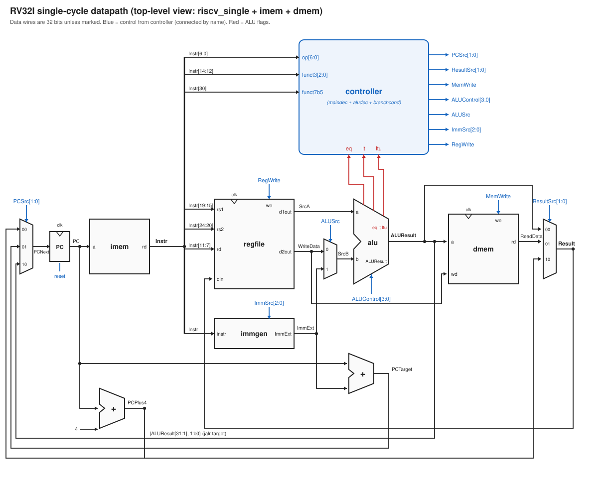

# Single-cycle design documentation

| File | Contents |
|---|---|
| [`hierarchy.svg`](hierarchy.svg) | Module hierarchy with instance names |
| [`top_structure.svg`](top_structure.svg) | `top`: CPU core + `imem` + `dmem` |
| [`riscv_single_structure.svg`](riscv_single_structure.svg) | `riscv_single`: controller + datapath, and the signals between them |
| [`datapath_single_cycle.svg`](datapath_single_cycle.svg) | Full single-cycle datapath (Figure 7.15 adapted to this design) |
| [`control_tables.md`](control_tables.md) | Main decoder, ALU control, branch condition, PCSrc and immediate tables |
| [`blocks/`](blocks/) | One block diagram per module (ports, widths, parameters) |

